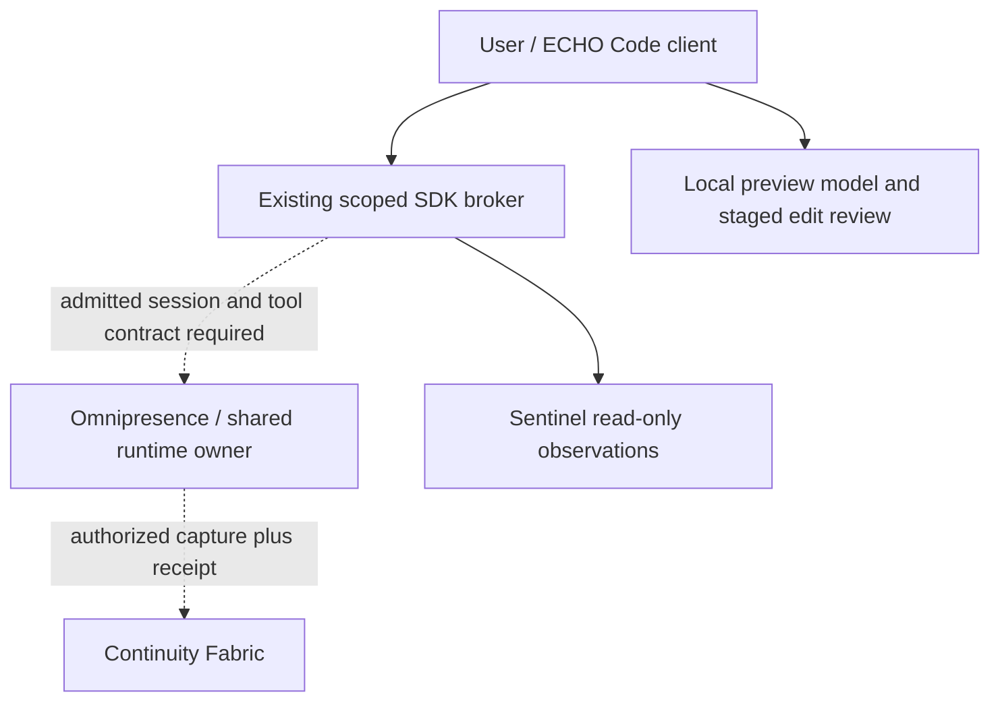

# Omnipresence / Single Runtime Engine / Sentinel integration

Recommended architecture: ECHO Code is the coding client. The existing Omnipresence runtime owns admitted cross-session/tool coordination; Sentinel supplies independent health/security observations and uses only separately authorized controls. Fabric remains the durable ledger/knowledge owner. Provider credentials and scopes stay in the existing broker. Local preview sessions are offline working state, not a second authoritative fleet runtime or Fabric replacement.



Current measured contract discovery:

- `echo.omnipresence.status`: registered, read-only, requires omnipresence.read. Invocation returned 403 scope_forbidden. A registry health label is not live state.
- `echo.omnipresence.health`: registered. It was not used to bypass the status scope denial.
- `echo.sentinel.health`: returned service echo-sentinel, version 1.15.0-r51, continuous_running true. It also reported gitleaks, trufflehog and semgrep not_installed, bandit available, and last defend grade 78. This is an owner health observation, not a scan of this ECHO Code candidate and not certification.
- Exact probes for echo.sre.health and echo.sentinel.status were unregistered. This does not prove that the intended Single Runtime Engine is absent; its authoritative session/tool interface has not been located/admitted in this task.

Implemented: `src/code/owners.ts` provides a fixed, read-only host SDK adapter for the two established owner status capabilities. It accepts the host's existing authenticated invocation function; it never loads credentials, expands scopes, dispatches remediation, starts a monitor or supplies a model-selected capability. Responses are normalized to allowlisted metadata. Missing broker, denied scope, transport failure, semantic error and identity mismatch remain distinct. Every result states runtimeAdmission=not_established.

The standalone `echo-code integrations` command exposes those contracts and truthfully reports no attached host broker. This is an integration boundary and diagnostic view, not a running shared engine. Sentinel health does not authorize source edits, certify a candidate or select a new inference placement. A larger model must use an admitted node with measured resource budgets; production FORGE is not an unrestricted inference host.

Host adapter use, after owner admission:

```typescript
import { collectOwnerReadiness } from './dist/code/owners.js';
// existingScopedInvoke is supplied by the already-authorized SDK host.
const observations = await collectOwnerReadiness(existingScopedInvoke);
```

Before activating shared execution: identify the Single Runtime Engine's canonical versioned session/tool contract; obtain its actual admitted role scope; bind workspace, cancellation, approvals, telemetry and replay/idempotency semantics; run readback/recovery tests; then complete exact-SHA release gates. Do not invent a second scheduler, bypass scope denial, or mark an integration live because its adapter tests pass.
